 

 

 

---

## ✦ 01 / PROFILE

I'm **Kamalampally Ruchith Reddy**, a **B.Tech Computer Science Engineering student (Class of 2028)** from India, aspiring to become an **AI Engineer**, specializing in **Applied AI and Generative AI**.

My interest lies in building practical AI-powered applications by connecting language models with software, data, tools and real-world workflows. I focus on understanding how AI systems work, how they can be integrated into applications, and how their outputs can be evaluated for quality and reliability. I develop my foundation through programming, Machine Learning, hands-on experimentation, structured learning and personal projects.

> **My direction:** Engineer useful AI applications through thoughtful implementation, effective integrations, reliable workflows and continuous evaluation.

## ✦ 02 / CAREER FOCUS

**Primary direction: AI Engineering | Applied AI | Generative AI**

My career interests include:

- **LLM application development** — model APIs, structured outputs, context-aware application workflows and integration with software systems.
- **Retrieval-Augmented Generation (RAG)** — connecting language models to relevant external knowledge and improving answer grounding.
- **AI agents & automation** — tool calling, multi-step execution, service integrations and workflow orchestration.
- **AI quality & reliability** — prompt design, context engineering, evaluation, testing, error handling and iterative improvement.
- **AI-assisted engineering** — vibe coding, AI pair programming and harness engineering, with human review and verification.

These represent my current career direction and areas of interest, not claims of professional employment or advanced expertise.

## ✦ 03 / TECHNICAL TOOLKIT

### Programming Languages

### Data Analysis & Machine Learning Libraries

### Development & Version Control

## ✦ 04 / MACHINE LEARNING & DATA SCIENCE

My Machine Learning foundation covers the practical model-development workflow: exploring data, preparing features, training models and evaluating performance.

### Data Understanding & Preparation

- **Exploratory Data Analysis (EDA):** examine distributions, relationships, patterns and data-quality issues.
- **Data preprocessing:** handle missing values, encode categorical variables and scale numerical features.
- **Outlier analysis:** identify unusual observations and choose appropriate treatments based on the data and problem.

### Feature Engineering

- **Feature extraction:** derive useful information from existing data.
- **Feature construction:** create meaningful features from existing columns and relationships.
- **Feature selection:** retain relevant features while reducing noise and redundancy.

### Algorithms & Model Development

- **Supervised learning:** regression and classification.
- **Unsupervised learning:** clustering methods and their applications.
- **Dimensionality reduction:** PCA and LDA.
- **Model development:** train and compare models using Scikit-learn workflows.

### Model Evaluation

- Use appropriate training, validation and testing approaches.
- Select evaluation metrics based on the problem.
- Recognize data leakage, overfitting and underfitting.
- Assess model generalization, interpret results and understand model limitations.

**Practice stack:** Python · NumPy · Pandas · Scikit-learn

## ✦ 05 / APPLIED AI & GENERATIVE AI SYSTEMS

My focus is on engineering practical AI applications by connecting language models with software, data, APIs, tools and reliable workflows.

### LLM Application Engineering

- Integrate language models into applications through APIs.
- Design task-focused prompts and structured outputs.
- Connect model responses with application logic and user workflows.
- Manage context, validate responses and handle API or output failures.

### Retrieval-Augmented Generation (RAG)

- Build knowledge pipelines through document ingestion and processing.
- Apply chunking, embeddings and vector search to retrieve relevant information.
- Supply retrieved context to language models for grounded responses.
- Evaluate retrieval relevance and the quality of generated answers.

### AI Agents & Workflow Automation

- Use tool and function calling to connect models with external capabilities.
- Organize tasks into controlled, multi-step workflows.
- Use tool results to guide subsequent actions.
- Integrate AI workflows with APIs and application services.

### Evaluation, Reliability & AI Engineering

- Evaluate AI outputs for relevance, correctness and consistency.
- Validate structured responses and test normal, edge and failure cases.
- Apply error handling, guardrails, tool permissions and human review where appropriate.
- Explore harness engineering through the tools, tests, logs and feedback loops that improve AI workflow reliability.

**Development practices:** Prompt engineering · Context engineering · AI workflow automation · Vibe coding · AI pair programming · Harness engineering

## ✦ 06 / AI TOOLS, MODELS & PLATFORMS

Tools and platforms I use or have explored across AI-assisted development, model experimentation, application projects and structured learning.

### AI Assistants & Coding Agents

 

Used or explored for understanding concepts, planning tasks, generating and reviewing code, debugging, and iterating on software.

### Model Ecosystem & Local AI

Exploring model options, local model workflows and API-based integration for AI-powered applications.

### Data Platforms & Application Services

Platforms connected to application data, project experimentation and practical learning.

### Learning Platforms

Used for structured learning and AI-related courses and credentials.

**How I work with these tools:** define the task, provide relevant context, compare implementation options, inspect generated code, debug, test normal and failure cases, and refine the result. AI output is a suggestion to verify—not automatically correct code.

### Open-source AI Engineering Repositories

Selected external projects worth studying for my Applied AI and Generative AI direction. These are **upstream learning references, not projects authored by me**.

| Repository | What it is useful for |
|:--|:--|
| [OpenAI Agents SDK](https://github.com/openai/openai-agents-python) | Building tool-using agents with handoffs, guardrails, sessions and tracing. |
| [LangGraph](https://github.com/langchain-ai/langgraph) | Designing stateful, long-running agent workflows with durable execution and human oversight. |
| [Google ADK for Python](https://github.com/google/adk-python) | Developing, evaluating and deploying code-first agent systems, including multi-agent workflows. |
| [LlamaIndex](https://github.com/run-llama/llama_index) | Building document-processing, retrieval-augmented generation (RAG) and agentic applications. |

## ✦ 07 / SELECTED PROJECTS

  
  
  

<table>
<tr>
<td width="50%" valign="top">

**[AI Resume Parser ↗](https://github.com/ruchith7111-dev/Ai_Resume_Parser)**

AI-ASSISTED DOCUMENT PROCESSING

A resume-processing application that uses Google's Gemini API to turn PDF resumes into structured candidate information.

- PDF text extraction with `pdf-parse`
- Gemini-based parsing of skills, experience, education and certifications
- JSON data storage and REST API endpoints
- Dashboard to search, view and delete parsed resumes

</td>
<td width="50%" valign="top">

**[SkillForge ↗](https://github.com/ruchith7111-dev/SkillForge)**

PYTHON · SKILL & PRACTICE TRACKING

A console application for managing skills, practice hours and learning targets.

- Add, update, filter and review skill records
- Configurable hours-per-level calculations
- Progress summaries and data export, including PDF
- JSON persistence and unit tests

</td>
</tr>
<tr>
<td colspan="2" valign="top">

**[CodeWhiz ↗](https://github.com/ruchith7111-dev/CodeWhiz)**

PYTHON · CODING PRACTICE TRACKING

A console application for recording coding sessions and reviewing practice activity.

- Session management with date, language, category, hours and notes
- Add, view, update, delete and filter operations
- Total-hour and category-wise reports
- JSON persistence, input validation and unit tests

</td>
</tr>
</table>

## ✦ 08 / ENGINEERING PRINCIPLES

**UNDERSTAND** &nbsp; → &nbsp; **PLAN** &nbsp; → &nbsp; **BUILD** &nbsp; → &nbsp; **REVIEW** &nbsp; → &nbsp; **TEST** &nbsp; → &nbsp; **REFINE**

I aim to understand the requirement before coding, plan the smallest useful implementation, inspect the result, test normal and failure cases, and improve it based on evidence. This is especially important when using AI coding assistants: generated code is a starting point, not proof that a task is complete.

## ✦ 09 / GITHUB ACTIVITY

<picture>
  <source media="(prefers-color-scheme: dark)" srcset="https://github-profile-summary-cards.vercel.app/api/cards/profile-details?username=ruchith7111-dev&amp;theme=github_dark"/>
  
</picture>

<table>
  <tr>
    <td width="50%">
      <picture>
        <source media="(prefers-color-scheme: dark)" srcset="https://github-profile-summary-cards.vercel.app/api/cards/stats?username=ruchith7111-dev&amp;theme=github_dark"/>
        
      </picture>
    </td>
    <td width="50%">
      <picture>
        <source media="(prefers-color-scheme: dark)" srcset="https://github-profile-summary-cards.vercel.app/api/cards/repos-per-language?username=ruchith7111-dev&amp;theme=github_dark"/>
        
      </picture>
    </td>
  </tr>
</table>

 

## ✦ 10 / VERIFIED CREDENTIALS & CONTINUED LEARNING

### Verified Digital Badges

*Select a badge to open its issuer-hosted verification page.*

**Credly · IBM SkillsBuild**

  
  
  

- **Foundations in Generative AI** — IBM SkillsBuild · Issued 22 May 2026
- Two additional Credly badge records are linked above; their exact titles are not displayed here because they have not been confirmed.

**Google Cloud Skills Boost**

  
  
  

- [Introduction to Responsible AI](https://www.skills.google/public_profiles/353db11c-77ad-4c07-96fc-92776862955a/badges/25272023)
- [Introduction to Large Language Models](https://www.skills.google/public_profiles/353db11c-77ad-4c07-96fc-92776862955a/badges/25271933)
- [Introduction to Generative AI](https://www.skills.google/public_profiles/353db11c-77ad-4c07-96fc-92776862955a/badges/25271659)

### Course Completion Certificates

| Certificate | Issuer | Completed |
|:--|:--|:--|
| What Is Generative AI? | LinkedIn Learning | 2 February 2026 |

### Additional Courses & Learning Achievements

- Create Your First Gemini Enterprise Application — Google
- Getting Started with Generative AI — IBM
- GUVI Webinar: Master Dashboard Creation — HCL GUVI
- AI Fluency for Students — Anthropic
- 5-Day AI Agents Intensive Vibe Coding Course — Google & Kaggle
- AI Skills Fest 2026 — Microsoft

### IBM SkillsBuild Digital Stickers

- Introduction to Large Language Models
- Ethical Considerations for Generative AI
- Foundations in Generative AI
- Build Your First Chatbot

## ✦ 11 / CONNECT

 

BUILD PRACTICALLY. THINK CRITICALLY. KEEP ITERATING.

